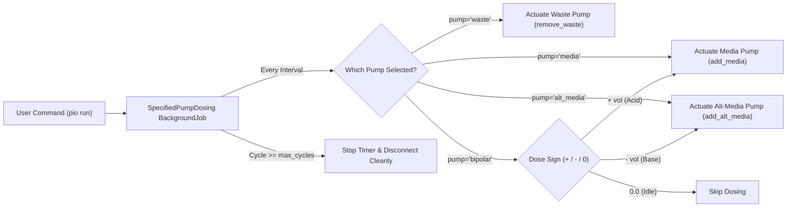

# Specified Pump Dosing Plugin (v1.2.0)

The **Specified Pump Dosing Plugin** executes a sequence of doses using any user-selected pump (`media`, `alt_media`, `waste`, or `bipolar`) on the [Pioreactor](https://pioreactor.com/) system. It runs for a specified number of cycles and shuts down **only the designated pump** upon completion, leaving all other running pumps (such as continuous media and waste pumps) completely untouched and active.

---

## 📸 Architecture & Workflow



---

## 🌟 Why Other Pumps Stay Running (Isolation & Background Daemon)

1. **No Master Dosing Hook**: Inherits from `BackgroundJobContrib` rather than `DosingAutomationJobContrib`. Pioreactor does NOT issue a global pump shutdown on completion.
2. **Disconnect-Proof**: Registered as a native background job daemon. You can close your SSH terminal, turn off your laptop, or disconnect from Wi-Fi — the job continues running reliably on the Pioreactor.
3. **Bipolar Dual-Pump Synchronization**: In `bipolar` mode, a single timer process drives both the `media` and `alt_media` pumps, eliminating timing drift and MQTT collisions.

---

## ⚙️ Configuration Parameters

| Parameter | Type | Default | Description |
| :--- | :---: | :---: | :--- |
| `pump` | `string` | `"media"` | Target pump: `"media"`, `"alt_media"`, `"waste"`, or `"bipolar"`. |
| `duration` | `float` | `20.0` | Schedule interval in minutes between dosing steps (e.g. `1.0` for 60s, `0.25` for 15s). |
| `volume_sequence` | `string` | `""` | Comma-separated list of volumes in mL. In bipolar mode: positive = media (acid), negative = alt_media (base). |
| `sequence_file` | `string` | `""` | Path to `.csv` or `.txt` dose schedule (e.g. `stage4_sequence_600steps.csv`). |
| `default_volume_ml` | `float` | `0.10` | Fixed volume used if sequence is empty. |
| `max_cycles` | `integer` | `len(sequence)` | Total cycles to run before auto-stopping (0 = unlimited). |

---

## 🚀 How to Run

### 1. Ultra-Fast 15-Second Test (1 Acid + 1 Base, 15s Apart)
```bash
pio run specified_pump_dosing \
    --pump bipolar \
    --duration 0.25 \
    --volume-sequence "0.01, -0.01" \
    --max-cycles 2
```
- Cycle 0 ($t = 0\text{ s}$): $+0.01\text{ mL} \rightarrow$ fires **`media`** pump.
- Cycle 1 ($t = 15\text{ s}$): $-0.01\text{ mL} \rightarrow$ fires **`alt_media`** pump.
- Cycle 2: Automatically disconnects.

---

### 2. Main Stage 4 Benchmark Run (600 Steps, 1-Min Interval, ~10 Hours)

Pass the CSV file directly:
```bash
pio run specified_pump_dosing \
    --pump bipolar \
    --duration 1.0 \
    --sequence-file stage4_sequence_600steps.csv \
    --max-cycles 600
```
Or using the generated signed text sequence:
```bash
pio run specified_pump_dosing \
    --pump bipolar \
    --duration 1.0 \
    --volume-sequence "$(cat volume_sequence_bipolar.txt)" \
    --max-cycles 600
```

---

## 📊 Database Logging

All doses executed are logged to `specified_pump_dosing_records`:
```bash
sqlite3 /home/pioreactor/.pioreactor/storage/pioreactor.sqlite \
  "SELECT timestamp, cycle, pump, volume_ml FROM specified_pump_dosing_records ORDER BY timestamp DESC LIMIT 10;"
```
